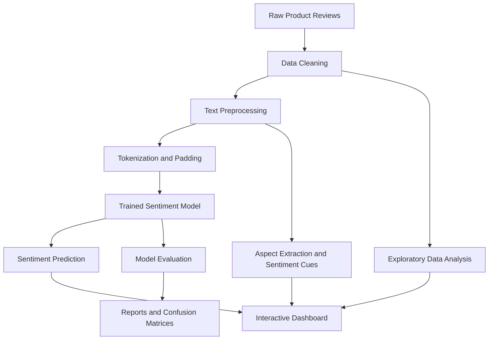

# ReviewIQ — Product Review Intelligence System

An end-to-end Natural Language Processing (NLP) and Deep Learning application that transforms customer product reviews into sentiment predictions, product aspect insights, and interactive analytics.

## Overview

ReviewIQ analyzes customer feedback using machine learning and deep learning techniques. It provides an interactive interface for individual review analysis, batch predictions, sentiment analytics, and model performance evaluation.

## Key Features

- **Sentiment Classification:** Classifies reviews as Positive, Neutral, or Negative.
- **Deep Learning:** Uses a Bidirectional LSTM (BiLSTM) with an Attention mechanism.
- **Baseline Comparison:** Evaluates TF-IDF with Logistic Regression against deep learning models.
- **Aspect Intelligence:** Extracts supported product aspects using rule-assisted logic and sentiment cues.
- **Interactive Dashboard:** Displays review distributions, customer feedback patterns, and visual analytics.
- **Batch Prediction:** Supports analysis of multiple reviews.
- **Model Evaluation:** Includes classification reports, confusion matrices, and model comparison results.

## Technology Stack

| Category | Technologies |
|---|---|
| Programming | Python |
| Data Processing | Pandas, NumPy |
| Machine Learning | Scikit-learn |
| Deep Learning | TensorFlow, Keras |
| NLP | Text preprocessing, tokenization, word embeddings |
| Models | Logistic Regression, BiLSTM, BiLSTM + Attention |
| Visualization | Plotly, Matplotlib, Seaborn |
| Application | Streamlit |

## Project Architecture



*The diagram is a high-level representation; the final architecture should match the actual model implementation.*

## Dataset

The project uses an Amazon Reviews 2023 Cell Phones & Accessories dataset.

- **Processed reviews:** 99,750
- **Sequence length:** 200 tokens
- **Sentiment classes:** Negative, Neutral, Positive

The repository contains raw and processed dataset artifacts. Add the original dataset source, license information, label-generation method, and preprocessing details after verifying them against the data preparation scripts.

## Model Evaluation

The project includes evaluation artifacts for three approaches:

- TF-IDF + Logistic Regression
- BiLSTM
- BiLSTM + Attention

Performance is evaluated using accuracy, precision, recall, F1-score, and confusion matrices. Refer to `reports/model_comparison.csv` and the individual classification reports for the recorded results.

## Repository Structure

```text
Product-Review-Intelligence/
├── app.py
├── config/
├── data/
│   ├── raw/
│   └── processed/
├── models/
├── notebooks/
├── reports/
│   └── figures/
├── src/
│   ├── aspect/
│   ├── data/
│   ├── evaluation/
│   ├── features/
│   ├── models/
│   ├── preprocessing/
│   └── training/
├── README.md
└── requirements.txt
```

## Getting Started

### 1. Clone the repository

```bash
git clone https://github.com/roshnichauhan/Product-Review-Intelligence.git
cd Product-Review-Intelligence
```

### 2. Create a virtual environment

```bash
python -m venv .venv
```

Activate it on Windows:

```bash
.venv\Scripts\activate
```

### 3. Install dependencies

```bash
python -m pip install --upgrade pip
python -m pip install -r requirements.txt
```

### 4. Run the application

```bash
streamlit run app.py
```

Ensure the required model files, tokenizer, label encoder, dataset, and custom Python modules are present before launching the application.

## Limitations

- Neutral sentiment may be harder to classify than positive sentiment.
- Aspect-level sentiment relies on rule-assisted logic and should not be interpreted as a separately trained supervised aspect-based sentiment model.
- Sarcasm, mixed sentiment, and unfamiliar product domains can reduce prediction reliability.
- Evaluation results depend on the dataset, label quality, and train-test split.
- A local application does not imply that a public demo is deployed.

## Future Improvements

- Improve performance on minority sentiment classes.
- Evaluate on an independent dataset.
- Add more robust explainability and confidence calibration.
- Deploy a public demo with reproducible setup instructions.
- Expand aspect extraction and evaluation.

## Author

**Roshni Chauhan**

GitHub: [roshnichauhan](https://github.com/roshnichauhan)

